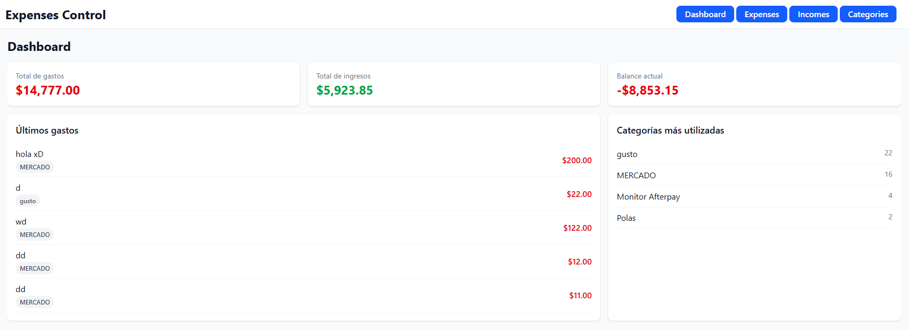
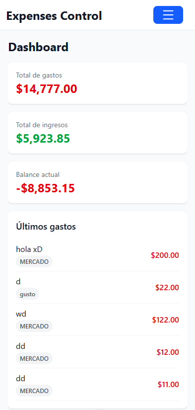

# Expenses Control

A full-stack personal finance app to track income and expenses, organise spending by category and spot small recurring "hormiga" (ant) expenses that add up over time.

**Live demo:** <expenses-control-frontend-sigma.vercel.app>
**Backend repo:** <https://github.com/CamiloQspec12/expensesControl-backend>



## Features

- Sign up and log in with JWT authentication
- Create expenses, incomes and categories
- Dashboard with total expenses, total income, balance and most used categories
- Form validation on both the frontend and the backend
- Loading states and clear error messages (validation, server and expired-session errors)
- Responsive layout with a mobile menu

## Tech stack

**Frontend:** Vue 3 (Composition API), Pinia, Vue Router, Axios, Tailwind CSS, Vite
**Backend:** Node.js, Express, Prisma, PostgreSQL, JWT, bcrypt
**Deployment:** Vercel (frontend), Railway (backend and database)

## Screenshots

| Desktop                          | Mobile                                  |
| -------------------------------- | --------------------------------------- |
|  |  |

## Getting started

### Prerequisites

- Node.js <version>
- PostgreSQL running locally

### Backend

```bash
git clone <backend-repo-url>
cd <backend-folder>
npm install
cp .env.example .env
npx prisma migrate dev
npm run dev
```

### Frontend

```bash
git clone <frontend-repo-url>
cd <frontend-folder>
npm install
cp .env.example .env
npm run dev
```

## Environment variables

**Backend (`.env`)**

| Variable       | Description                                          |
| -------------- | ---------------------------------------------------- |
| `DATABASE_URL` | PostgreSQL connection string                         |
| `JWT_SECRET`   | Secret used to sign tokens                           |
| `PORT`         | Server port (default 3000)                           |
| `NODE_ENV`     | `production` enables SSL for the database connection |

**Frontend (`.env`)**

| Variable       | Description                                                   |
| -------------- | ------------------------------------------------------------- |
| `VITE_API_URL` | Base URL of the backend API, e.g. `http://localhost:3000/api` |

## What I learned

- Deploying a full-stack app: Vercel + Railway, CORS between environments, environment-specific database SSL
- Handling errors across layers: validation, 400/401/500 responses and an Axios interceptor for expired sessions
- Building a responsive layout with Tailwind's mobile-first approach

## Next steps

- <e.g. automated tests>
- <e.g. charts on the dashboard>
